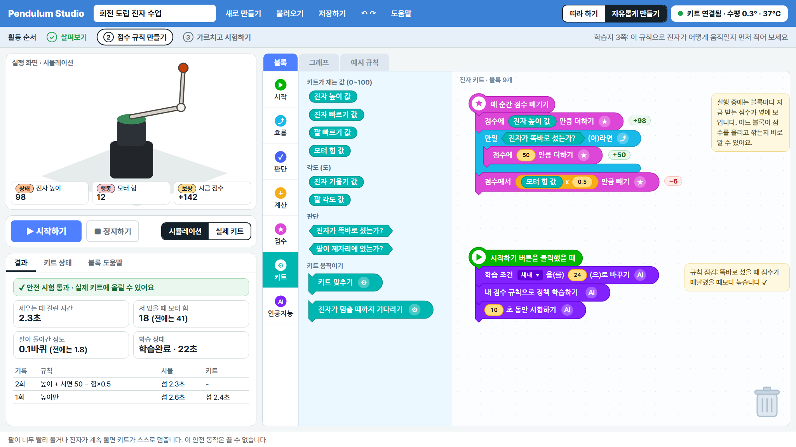

# Pendulum Studio 블록·화면 개선 설계안

작성 2026-11-24 · 8절의 1~5번 구현 완료 (5번 rev11 물리·SAC 정책·조건 섞기·안전 시험은 2026-11-25) (시안: `mockup.html`, 실제 화면: `app_free.png`, `app_guide.png`), 6번은 프로그램·가짜 장치 시험·실기 첫 실행까지 완료(2026-11-25, `app/kit/README.md`), USB 배선과 7번이 다음 순서

목표: 엔트리·스크래치로 블록 코딩을 배운 한국 초·중학생이 설명 없이 쓸 수 있게 한다.



---

## 1. 조사: 한국 학교에서 쓰는 블록 코딩 도구

웹과 실제 편집기 화면에서 확인한 내용이다. 출처는 문서 끝에 있다.

### 범주 구성

| 도구 | 범주 (화면 순서) |
|---|---|
| **엔트리** (사실상 표준) | 시작 · 흐름 · 움직임 · 생김새 · 붓 · 소리 · 판단 · 계산 · 자료 · 함수 · 데이터분석 · 인공지능 · 확장 · 하드웨어 |
| 스크래치 3.0 | 동작 · 형태 · 소리 · 이벤트 · 제어 · 감지 · 연산 · 변수 · 내 블록 |
| MakeCode (micro:bit) | 기본 · 입력 · 음악 · LED · 라디오 · 반복 · 논리 · 변수 · 계산 · 고급 |

### 네 도구에 공통인 약속

| 약속 | 내용 |
|---|---|
| 시작 블록 | 모자 모양 블록이 맨 위에 있고 문구는 "~했을 때". 엔트리는 `시작하기 버튼을 클릭했을 때` |
| 블록 모양 | 값은 **둥근** 블록, 참/거짓은 **육각** 블록. 육각 칸에는 판단 블록만 들어간다 |
| 조건 | 엔트리 `만일 <참> (이)라면`, 아니면은 `아니면` |
| 변수 | 한 쌍으로 쓴다: `[변수] 에 (10) 만큼 더하기`, `[변수] 를 (10) (으)로 정하기` |
| 센서 | `(무엇) 센서값`처럼 "값"으로 끝나는 둥근 블록 |
| 하드웨어 | 범주 맨 끝에 있고, `하드웨어 연결하기` 버튼 하나로 연결을 시작한다 |
| 화면 | 팔레트 → 조립 공간이 왼쪽에서 오른쪽으로. 엔트리는 실행 화면이 왼쪽 위, 그 아래 `▶ 시작하기` |

### 엔트리의 인공지능 블록 (우리 앱과 가장 가까운 부분)

- 단계: `데이터 입력하기 → 학습하기 → 결과 확인하기`
- 학습 조건 이름: `세대(Epoch)`, `배치 크기`, `학습률`
- 블록: `모델 다시 학습하기`, `모델이 학습되었는가?`, `학습 조건 [학습률] 을 (10) 으로 바꾸기`
- 상태 문구: `학습중 / 학습완료 / 모델없음`
- **강화학습 블록은 없다.** 도움말에 "학습한 결과가 좋으면 보상을, 나쁘면 벌을 주며" 한 줄만 있다. 보상과 강화학습은 초·중학생 모두에게 새 개념이다.

### 교육과정 (2022 개정)

- 초등 5~6학년 실과: 순차·반복·선택, 간단한 변수
- 중학교 정보: 변수·리스트·중첩 조건·함수, 지도학습(분류) 체험
- 음수는 중학교 1학년에 배운다. 초등학생에게 "−0.2를 더하기"는 어렵다.

---

## 2. 지금 앱의 문제 (직접 눌러 본 결과)

| 문제 | 엔트리에 익숙한 학생이 느끼는 것 |
|---|---|
| 블록 화면이 2번 탭 → '심화' 버튼 뒤에 있다 | 블록이 어디 있는지 모른다 |
| 블록을 쌓는 화면에 키트 그림이 없다 | 규칙을 바꿔도 결과가 안 보인다 |
| 시작 블록(모자)이 "점수 규칙", "가르치기 설정"이다 | "~했을 때"가 아니라서 언제 실행되는지 모른다 |
| `점수 더하기 (cos (진자 각도))`, `0.2 × 제곱(진자 빠르기)` | cos·제곱·rad는 배우지 않았다 |
| 시뮬레이션/키트 선택이 세 군데에 있다 | 어디서 바꾸는지 헷갈린다 |
| 메뉴에 장치·연결·펌웨어 안내가 따로 있다 | 무엇을 눌러야 연결되는지 모른다 |
| 가르치기 설정은 2번 탭, 가르치기 버튼은 3번 탭 | 설정과 실행이 떨어져 있다 |

---

## 3. 블록 설계

### 범주 (엔트리의 이름·색·순서를 따른다)

| 범주 | 색 | 블록 | 모양 |
|---|---|---|---|
| **시작** | 초록 #00b400 | `▶ 시작하기 버튼을 클릭했을 때` | 모자 |
| **흐름** | 하늘 #19baea | `만일 < > (이)라면` / `만일 < > (이)라면 … 아니면` | 감싸는 블록 |
| **판단** | 파랑 #4562f5 | `( ) < ( )` / `( ) > ( )` / `< > 그리고 < >` / `< > 또는 < >` / `< > (이)가 아니다` | 육각 |
| **계산** | 노랑 #f4af18 | `( ) + ( )` / `−` / `x` / `÷` / `( ) 의 [제곱 ▾]` (제곱·절댓값) | 둥근 |
| **점수** | 자홍 #dd47d8 | `매 순간 점수 매기기`(모자) / `점수에 ( ) 만큼 더하기` / `점수에서 ( ) 만큼 빼기` | 모자, 쌓기 |
| **키트** | 청록 #00b6b1 | 아래 표 | 둥근, 육각 |
| **인공지능** | 보라 #8222ff | `학습 조건 [세대 ▾] 을(를) ( ) (으)로 바꾸기` / `내 점수 규칙으로 정책 학습하기` / `( ) 초 동안 시험하기` | 쌓기 |

- '점수'는 엔트리의 '자료'(변수) 자리와 색을 쓴다. `점수에 ( ) 만큼 더하기`는 엔트리의 `[변수] 에 (10) 만큼 더하기`와 같은 문장이다.
- `점수에서 ( ) 만큼 빼기`는 엔트리에 없지만 넣는다. 초등학생은 음수를 모른다.
- '키트'는 엔트리의 '하드웨어' 자리와 색을 쓴다.

### 블록 모양: 엔트리와 같은 도형 규칙

엔트리 편집기(playentry.org/ws/new)의 블록 경로에서 치수를 읽어 그대로 따른다. 시안(`mockup.html`)의 블록은 이 규칙으로 그렸다.

| 블록 | 모양 | 치수 |
|---|---|---|
| 쌓기 블록 | 왼쪽 위에 V 모양 홈, 왼쪽 아래에 V 모양 돌기, 오른쪽 끝은 반원 | 높이 28, 홈 폭 12·깊이 6 |
| 모자 블록 | 왼쪽에 아이콘이 든 원, 아래에 V 돌기 | 원 반지름 17, 몸통 높이 28. 아래 블록은 12만큼 들여서 붙는다 |
| 감싸는 블록 (`만일`) | 위 막대 + 안쪽 칸 + 얇은 아래 막대 | 위 28, 들여쓰기 14, 아래 15 |
| 값 블록 | 양 끝이 둥근 캡슐 | 높이 20 |
| 판단 블록 | 양 끝이 뾰족한 육각 | 높이 20, 끝 폭 8 |
| 숫자 칸 | 노란 캡슐(#ffde82, 테두리 #FF9C00), 검은 글씨 10px | 높이 20 |
| 고르는 칸 | 범주 색보다 어두운 네모 + ▼ | 높이 18 |
| 글씨 | 나눔고딕 굵게 12px, 흰색 | |
| 테두리 | 범주 색보다 한 단계 어두운 색 1px | |
| 블록 끝 아이콘 | 범주를 나타내는 작은 원 아이콘 | 지름 22 |

로고·캐릭터·아이콘 그림은 가져오지 않고, 모양 규칙과 색만 따른다. 아이콘은 우리 것으로 새로 그린다.

### 키트 블록: 단위를 0~100으로 통일

| 블록 | 값 | 지금 앱 |
|---|---|---|
| `진자 높이 값` | 0(매달림) ~ 100(똑바로 섬) | 0~1 |
| `진자 빠르기 값` | 0 ~ 100 (안전 정지 속도가 100) | rad/s |
| `팔 빠르기 값` | 0 ~ 100 (안전 정지 속도가 100) | rad/s |
| `모터 힘 값` | 0 ~ 100 (최대 힘이 100, 방향 무시) | −1~1 |
| `진자 기울기 값` | 0°(똑바로) ~ 180°(매달림) | rad |
| `팔 각도 값` | 처음 자리에서 돌아간 각도(°), 방향 무시 | rad |
| `진자가 똑바로 섰는가?` | 기울기 10° 안이고 천천히 움직이면 참 | 0/1 값 |
| `팔이 제자리에 있는가?` | 팔 각도 30° 안이면 참 | 없음 |

- 모든 값을 0~100으로 맞추면 "높이 100점에서 힘 20점을 깎는다"처럼 블록끼리 크기를 비교할 수 있다.
- 방향(부호)을 없애면 제곱이나 절댓값 없이도 "빠를수록 감점"을 쓸 수 있다.
- cos·sin은 뺀다. `진자 높이 값`이 같은 역할을 한다.

### 인공지능 블록: 엔트리 문구에 맞춘다

| 지금 | 바꾼 뒤 |
|---|---|
| 몇 번 고쳐 볼까 (24) 번 | `학습 조건 [세대 ▾] 을(를) (24) (으)로 바꾸기` |
| 한 번에 몇 개 해 볼까 (20) 개 | `학습 조건 [한 세대에 해 볼 수 ▾] 을(를) (20) (으)로 바꾸기` |
| 얼마나 크게 바꿀까 (0.06) | `학습 조건 [바꾸는 크기 ▾] 을(를) (6) (으)로 바꾸기` (1~30 눈금) |
| (3번 탭의 가르치기 버튼) | `내 점수 규칙으로 정책 학습하기` |
| (3번 탭의 시험 버튼) | `( ) 초 동안 시험하기` |

---

## 4. 학생이 보상 함수를 만드는 방법

### 프로그램은 두 묶음

```
[매 순간 점수 매기기]                      ← 점수 규칙 (보상 함수)
  점수에 (진자 높이 값) 만큼 더하기
  만일 <진자가 똑바로 섰는가?> (이)라면
      점수에 (50) 만큼 더하기
  점수에서 ((모터 힘 값) x (0.5)) 만큼 빼기

[▶ 시작하기 버튼을 클릭했을 때]            ← 가르치고 시험하기
  학습 조건 [세대] 을(를) (24) (으)로 바꾸기
  내 점수 규칙으로 정책 학습하기
  (10) 초 동안 시험하기
```

- `매 순간 점수 매기기`는 키트가 0.02초마다 한 번씩 실행한다고 설명한다. 엔트리의 `계속 반복하기`와 같은 감각이다.
- `▶ 시작하기`를 누르면 학습(약 20초) → 시험이 한 번에 이어진다. 탭을 옮기지 않는다.

### 세 단계로 어려워진다

| 단계 | 학생이 하는 일 | 학습 시간 |
|---|---|---|
| **따라 하기** | 미리 쌓인 블록에서 `[없음 / 약하게 / 강하게 ▾]`만 고른다 (지금의 '기본', 9칸) | 없음 (미리 학습한 정책) |
| **자유롭게 만들기 1** | 숫자를 바꾸고 `점수에 ~ 더하기/빼기`를 더 쌓는다 | 약 20초 |
| **자유롭게 만들기 2** | `만일 ~ (이)라면`으로 조건을 건다 | 약 20초 |

- '따라 하기'도 같은 블록 화면에서 한다. 블록은 고정되고 고르는 칸만 열린다. 화면이 하나라서 '자유롭게 만들기'로 넘어가도 낯설지 않다.
- `예시 규칙` 탭에서 완성된 규칙을 불러온다: 힘 아끼기, 팔 제자리, 조용히 서기 등 오늘 시험한 것.

### 만든 규칙이 맞는지 바로 알려 준다

| 시점 | 알려 주는 것 | 예 |
|---|---|---|
| 블록을 놓는 순간 | **규칙 점검**: 똑바로 섰을 때와 매달렸을 때의 점수를 계산해 비교 | "이 규칙은 매달려 있을 때 점수가 더 높아요" (더하기 대신 빼기를 쓴 실수) |
| 블록을 놓는 순간 | 진자가 빨리 돌 때 점수가 가장 높으면 경고 | "빨리 돌릴수록 점수가 높아요. 키트가 안전 정지할 수 있어요" |
| 실행 중 | 블록마다 **지금 받는 점수**를 옆에 표시 (+98, +50, −6) | 어느 블록이 점수를 올리고 깎는지 보인다 |
| 학습 뒤 | **결과 카드**: 안전 시험 통과 여부, 세우는 시간, 서 있을 때 모터 힘, 팔이 돌아간 정도, 이전 기록과 비교 | "모터 힘 41 → 18" |

오늘 실험에서 부호를 반대로 쌓은 규칙과 "빨리 돌려라" 규칙은 학습까지 한 뒤에야 걸러졌다. 규칙 점검은 학습 전에 같은 실수를 잡는다.

---

## 5. 화면 구조

엔트리의 배치를 따른다.

| 영역 | 위치 | 내용 |
|---|---|---|
| 상단 메뉴 | 맨 위 | 작품 이름, 새로 만들기 / 불러오기 / 저장하기, 되돌리기, 도움말, `따라 하기 / 자유롭게 만들기`, **키트 연결하기** |
| 활동 순서 | 메뉴 아래 한 줄 | ① 살펴보기 ② 점수 규칙 만들기 ③ 가르치고 시험하기. 화면을 바꾸지 않고 지금 할 일과 학습지 쪽수만 알려 준다 |
| 실행 화면 | 왼쪽 위 | 키트 3D 그림, 상태·행동·보상 값 |
| 실행 버튼 | 실행 화면 바로 아래 | `▶ 시작하기`, `■ 정지하기`, `시뮬레이션 / 실제 키트` (한 곳에만) |
| 보조 창 | 왼쪽 아래 | 탭 `결과` / `키트 상태` / `블록 도움말` |
| 블록 영역 | 오른쪽 | 탭 `블록` / `그래프` / `예시 규칙`. 블록 탭은 범주 → 블록 꾸러미 → 블록 조립소 |

### 무엇이 없어지고 합쳐지나

| 지금 | 바꾼 뒤 |
|---|---|
| 탭 3개가 각각 다른 화면 | 화면 하나 + 활동 순서 안내 줄 |
| 기본 / 심화 버튼 (2번 탭 안) | 상단의 `따라 하기 / 자유롭게 만들기` |
| 메뉴의 언어, 편집, 장치, 연결, 펌웨어 안내 | `키트 연결하기` 버튼 하나 (연결 상태·수평·온도를 함께 표시) |
| 오른쪽 위 토글 + 3번 탭의 시험 버튼 2개 | 실행 버튼 옆 `시뮬레이션 / 실제 키트` 하나 |
| 3번 탭의 가르치기 버튼 | `▶ 시작하기` |

---

## 6. 라즈베리파이 USB 연결

### 연결 방법 (결정 필요)

| 방법 | 노트북에 보이는 것 | 장점 | 단점 |
|---|---|---|---|
| **A. USB-C 케이블 하나** (Pi를 USB 장치 모드로) | COM 포트 | 케이블 하나, 드라이버 설치 없음 | Pi 5 전원이 문제. 노트북 USB는 Pi 5가 요구하는 5 A를 못 준다 → 키트 안에서 Pi에 5 V를 따로 공급해야 한다. Pi 5 설정 확인 필요 |
| **B. USB-시리얼 어댑터** → Pi의 UART 핀 | COM 포트 | 전원이 분리돼 안전, 지금 바로 시험 가능 | 어댑터 부품 추가, 일부 칩(CH340)은 드라이버 설치 필요 |
| C. USB 이더넷 장치 모드 | 네트워크 | 파일 전송이 쉽다 | Windows 드라이버 문제가 잦다 |

추천: 시제품은 **B**로 바로 시험하고, 완성품은 키트 전원에서 Pi에 5 V를 공급하면서 **A**로 간다. 앱 쪽 코드는 둘 다 COM 포트라서 같다.

### 누가 모터를 제어하나: 정책은 Pi에서 돌린다

지금 `PROTOCOL.md`는 앱이 0.02초마다 모터 힘을 보내는 방식이다. 이렇게 하면 USB 지연이 그대로 제어 지연이 된다. 오늘 실험에서 지연 0.02~0.04초가 성패를 갈랐다.

| | 지금 프로토콜 | 바꿀 프로토콜 |
|---|---|---|
| 제어 루프 | 앱(노트북)이 매번 힘을 보냄 | **Pi가 정책을 직접 실행** (지금 `run_policy.py` 방식) |
| 앱 → Pi | `U <힘>` 50 Hz | 정책 가중치 4,673개를 한 번 전송 + `실행` 명령 |
| Pi → 앱 | 상태 50 Hz | 상태 50 Hz (그림·그래프용) |
| USB가 빠지면 | 100 ms 뒤 정지 | Pi가 즉시 안전 정지 |

추가할 명령: 정책 올리기, 실행/정지, 키트 맞추기(7절), 키트 정보 읽기.

Pi 쪽에는 조원 A의 `run_policy.py`, `kit_identify.py`, `session.py`를 감싸는 대기 프로그램 하나가 필요하다.

---

## 7. 키트 맞추기 (수평·영점·마찰·질량 보정)

> 2026-11-25 진행: 사용자 결정에 따라 **수평은 실행마다**(키트가 스스로, 팔 120°씩 두 번), **나머지는 연결할 때 확인 단추를 누른 뒤에만**(영점 네 자리 + 팔 마찰·관성 + 진자 주기)으로 나눠 만들었습니다.
> 아래 표의 1~4단계가 들어갔고(가짜 키트·기록 재계산으로 확인, 실기 시험 전), 5단계(일치 확인)와 "측정값을 어디에 쓰나"의 1~3은 아직입니다. 자세한 것은 `kit/README.md`.

조원 A가 만든 도구는 모두 터미널 명령이다. 이를 앱의 `키트 연결하기` 뒤에 이어지는 절차로 묶는다. 추가 센서 없이 진자 자체를 추로 쓴다.

| 단계 | 하는 일 | 걸리는 시간 | 이미 있는 것 | 새로 만들 것 |
|---|---|---|---|---|
| 0. 연결 점검 | CAN, 모터 온도, 진자 센서 확인 | 2초 | `session.py` | 앱 화면 |
| 1. **수평 맞추기** | 팔을 한 바퀴 천천히 돌리며 진자가 매달린 각도를 잰다 → 받침이 어느 쪽으로 몇 도 기울었는지 계산 | 30초 | 영점 식 맞춤 (오늘 2.39° → 0.30°로 줄임) | 수평계 그림: "이쪽 다리를 올리세요", 0.5° 안이면 통과 |
| 2. 진자 영점 | 1단계 값에서 함께 구함 | 0초 | 있음 | 없음 |
| 3. 팔 마찰·관성 | 전류 펄스 6개로 마찰과 관성 측정 | 10초 | `kit_identify.py` | 앱 화면 |
| 4. **진자 질량·길이** | 팔을 짧게 쳐서 진자를 흔든 뒤 브레이크로 팔을 고정하고 흔들리는 주기를 잰다 | 15초 | 손으로 들었다 놓는 실험만 있음 | 손을 대지 않는 자동 측정 |
| 5. **일치 확인** | 정해진 힘 순서를 키트와 시뮬에 똑같이 넣고 움직임을 비교 | 10초 | 개발용 스크립트만 있음 | "시뮬과 키트 일치도" 표시, 낮으면 다시 맞추기 |

### 질량 차이는 어떻게 잡나

- **팔 쪽**: 관성의 대부분은 모터 내부에서 온다(측정 0.0245, 팔 몸체는 0.0002). 3단계가 이 값을 직접 잰다. 무게를 달 필요가 없다.
- **진자 쪽**: 흔들리는 주기는 질량과 길이로 정해진다. 4단계에서 주기를 재면 끝의 볼트가 빠졌거나 다른 것으로 바뀐 것을 알 수 있다.
- **결합 0.87배, 토크 0.95배**: 키트 설계가 같으면 같은 값이다. 키트마다 재지 않고 설계가 바뀔 때 개발자가 한 번 잰다. 5단계가 이 값이 아직 맞는지 확인한다.

### 측정값을 어디에 쓰나

1. 앱 안 시뮬레이션이 **이 키트의 값**으로 바뀐다.
2. 고쳐 배우기는 이 키트의 값 주변 조건에서 점수를 매긴다.
3. 안전 시험(고정 시험)도 이 키트의 값 주변에서 한다.
4. 키트 번호별로 날짜·온도와 함께 저장한다.

### 언제 다시 맞추나

- 30분이 지났거나 모터 온도가 3°C 넘게 바뀌면 3단계만 다시 (조원 A의 규칙 그대로)
- 키트를 실행할 때마다 진자 영점을 2초 확인하고, 0.9° 넘게 어긋나면 1단계를 다시 안내

### 남은 문제

오늘 '힘 아주 아끼기' 정책은 시뮬 시험을 모두 통과하고도 실기에서 0/3이었다. 5단계 일치 확인에 "직립을 지나쳤을 때 다시 잡는가"를 넣고, 키트 쪽 안전 정지에 "진자가 2초 넘게 계속 돌면 정지"를 추가해야 한다.

---

## 8. 만드는 순서 (제안)

| 순서 | 작업 | 실기 필요 |
|---|---|---|
| 1 | 블록 정의 교체 (범주·문구·0~100 단위·육각 판단) | 아니오 |
| 2 | 감싸는 블록(`만일`) 지원, 규칙 점검 | 아니오 |
| 3 | 화면 하나로 합치기 (실행 화면 왼쪽, 보조 창, 활동 순서 줄) | 아니오 |
| 4 | 실행 중 블록별 점수 표시, 결과 카드 | 아니오 |
| 5 | 앱 시뮬레이션을 rev11 보정 환경으로 교체, SAC 바탕 정책·조건 섞기·고정 시험 반영 | 아니오 |
| 6 | Pi 대기 프로그램 + USB 연결 + 프로토콜 확장 | 예 |
| 7 | 키트 맞추기 절차 (수평계, 자동 진자 측정, 일치 확인) | 예 |

---

## 출처

- 엔트리 블록·화면·인공지능: docs.playentry.org (block_start, block_flow, block_decision, block_variable, block_hardware, popup_model, tab_block, header, screen), playentry.org/ws/new 실제 화면, github.com/entrylabs/entryjs
- 스크래치: scratch.mit.edu 편집기 한국어판, github.com/scratchfoundation/scratch-l10n
- MakeCode: makecode.microbit.org/?lang=ko 실제 화면
- mBlock: ide.mblock.cc 실제 화면
- 교육과정 시수: 뉴시스 2022-08-19, 정책브리핑. 성취기준 일부는 2차 자료로만 확인했고 고시 원문은 확인하지 못했다.
- 확인 못 한 것: Pi 5의 USB 장치 모드 설정과 전원 조건, 엔트리 이미지 모델 학습 화면의 세부 문구
