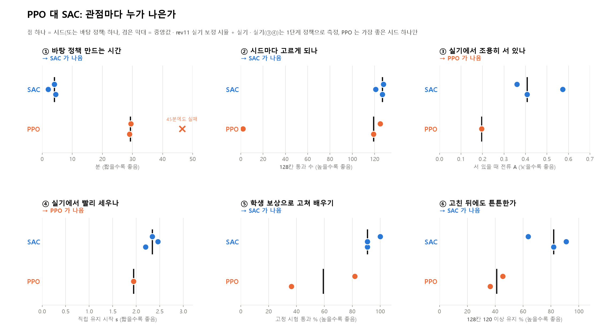
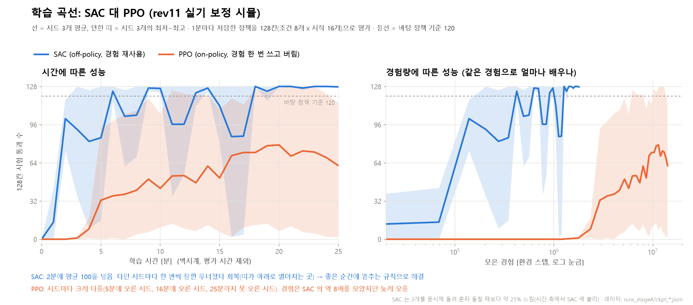
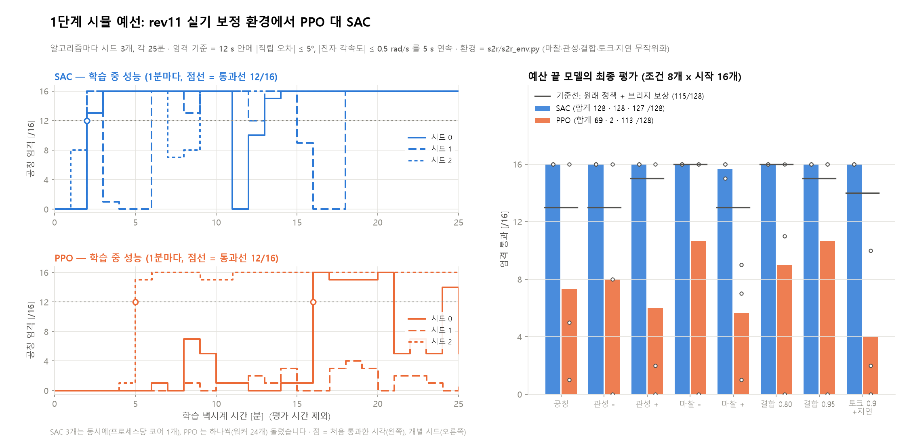
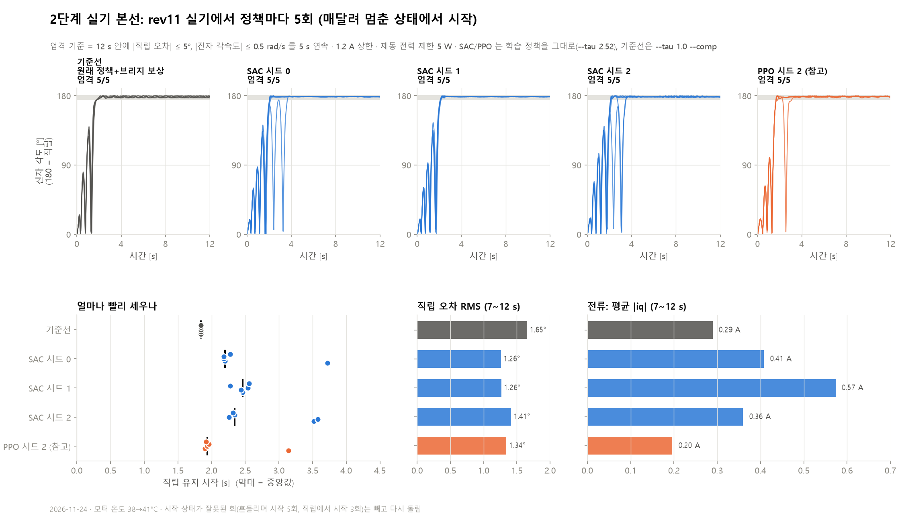
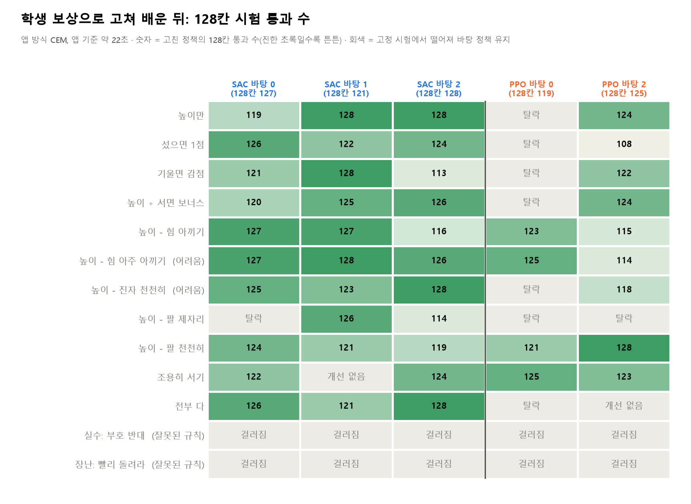

# 교육용 퍼루타 진자 키트, PPO와 SAC 중 무엇을 쓸까

작성 2026-11-24 · rev11 실기(MyActuator RMD-X6 + AS5600 + Raspberry Pi 5)와 실기에 맞춰 보정한 MuJoCo 시뮬레이션으로 측정

---

## 한 줄 결론

> **바탕 정책은 SAC로 만들고, 학생 수업에서는 그 정책을 1분 안에 '고쳐 배우게' 한다.**
> SAC는 빨리, 고르게 배우고 학생 보상으로 고쳐도 잘 버틴다. PPO는 다 배우면 더 조용히 서 있지만, 배우는 데 7배 이상 오래 걸리고 시드에 따라 아예 실패하기도 한다.



---

## 1. 무엇을 정하려고 했나

### 키트와 수업 흐름

- 학생은 앱(Pendulum Studio)에서 **블록으로 점수 규칙(보상)**을 만든다. 예: "진자가 높을수록 +점수", "모터를 세게 쓰면 −점수".
- 앱은 미리 학습해 둔 **바탕 정책**에서 출발해 학생 규칙에 맞게 **몇십 초 동안 고쳐 배운다**(CEM 방식).
- 고친 정책이 안전 시험을 통과하면 실제 키트에서 돌려 본다.

### 그래서 알고리즘에 바라는 것

| 바라는 것 | 왜 |
|---|---|
| 바탕 정책을 빨리, 확실하게 만든다 | 키트나 물리 모델이 바뀔 때마다 다시 만들어야 한다 |
| 학생 규칙으로 고쳐도 무너지지 않는다 | 수업 중 학생이 기다릴 수 있는 시간은 1분 안쪽이다 |
| 실제 키트에서 조용하고 확실하게 선다 | 교구는 발열·소음·안전이 중요하다 |

---

## 2. 두 알고리즘 한 장 설명

| | PPO (Proximal Policy Optimization) | SAC (Soft Actor-Critic) |
|---|---|---|
| 비유 | 문제집을 한 번 풀고 버린 뒤 새 문제집을 푼다 | 푼 문제를 오답노트에 모아 두고 계속 다시 푼다 |
| 데이터 쓰는 방식 | 방금 모은 경험으로만 배우고 버린다 (on-policy) | 경험을 저장해 두고 여러 번 다시 쓴다 (off-policy, 리플레이 버퍼) |
| 장점 | 한 번에 조금씩만 바꿔서 안정적이다. 구조가 단순하다 | 같은 경험으로 많이 배워서 빠르다 |
| 단점 | 경험이 많이 필요하다. 탐색을 운에 맡기는 편이다 | 학습 도중 잠깐 무너지는 일이 있다. 계산이 무겁다 |
| 탐색 방법 | 행동에 정해진 크기의 잡음을 섞는다 | "다양하게 행동할수록 보너스" 항을 보상에 더한다 (엔트로피 최대화) |

**용어 풀이**
- **정책**: 상태(각도·속도)를 보고 모터 힘을 정하는 작은 신경망
- **시드**: 난수 시작값. 같은 설정이라도 시드가 다르면 결과가 달라질 수 있다
- **128칸 시험**: 조건 8개(마찰·관성·결합·토크·지연을 바꿈) × 시작 자세 16개. 12초 안에 진자를 세워 ±5° 안에서 5초 버티면 1칸 통과
- **고쳐 배우기(파인튜닝)**: 처음부터 배우지 않고 이미 배운 정책을 조금씩 바꿔 새 목표에 맞추는 것

---

## 3. 어떻게 공정하게 비교했나

### 똑같이 맞춘 것

- 같은 환경: rev11 실기 측정값으로 보정한 시뮬레이션. 마찰·관성·결합·토크·지연을 같은 범위에서 무작위로 바꿈
- 같은 보상 식, 같은 입력(관측 6개)과 출력(모터 힘 1개), 같은 신경망 크기(64×64)
- 같은 시계: 실제 흐른 시간(벽시계)으로 재고, 평가에 쓴 시간은 뺌
- 같은 멈춤 규칙: 30초마다 32칸 빠른 시험, 30칸 이상이 2번 연속이면 학습 종료
- 같은 최종 시험(128칸), 알고리즘마다 시드 3개
- 실기: 같은 날, 같은 키트, 같은 전류 상한(1.2 A), 번갈아 가며 5회씩, 매번 진자가 멈춘 뒤 시작
- 고쳐 배우기: 같은 CEM 설정, 같은 학생 보상 13개, 같은 계산량(앱 기준 약 22초)

### 일부러 다르게 둔 것

각 알고리즘이 잘 돌아가는 표준 방식을 그대로 썼다. 억지로 같게 맞추면 오히려 한쪽이 불리해진다.

| | SAC | PPO |
|---|---|---|
| 동시에 돌리는 환경 수 | 8개 | 24개 |
| 초당 모으는 경험 | 약 1,200 스텝 | 약 8,000~11,000 스텝 |
| 신경망 활성화 함수 | ReLU | tanh |

### 남아 있는 불공정 (발표 때 꼭 밝힐 것)

- **조율**: SAC는 학습률 하나를 조율했고(효과 약 1.5배), PPO는 설정 4가지를 시험했지만 기본값보다 나은 것을 찾지 못했다. 조율 차이로 설명되는 건 1.5배 정도다.
- **실기 시험 수**: PPO는 가장 좋은 시드 1개만 올렸다(SAC는 3개).
- **다른 환경에서는 반대 결과**: 조원 B의 환경·구현에서는 PPO가 11~13분에 성공했고 SAC는 25분 안에 실패했다. "SAC가 항상 빠르다"고 일반화하면 안 된다.

---

## 4. 결과: 관점마다 누가 나은가

| 관점 | SAC | PPO | 나은 쪽 |
|---|---|---|---|
| ① 바탕 정책 만드는 시간 | 2.0 · 4.0 · 4.5분 | 29.0 · 29.5분, 1개는 45분에도 실패 | **SAC** (약 7배) |
| ② 시드마다 고르게 되나 (128칸) | 127 · 121 · 128 | 119 · 125 · **2** | **SAC** |
| ③ 실기에서 서 있을 때 전류 | 0.36 · 0.41 · 0.57 A | 0.20 A | **PPO** (절반 이하) |
| ④ 실기에서 세우기 시작한 시각 | 2.20 · 2.34 · 2.46초 | 1.94초 | **PPO** (조금) |
| 실기 엄격 통과 | 15/15 | 5/5 | 같음 |
| ⑤ 학생 보상으로 고쳐 배우기 성공 | 31/33 (94%) | 13/22 (59%) | **SAC** |
| ⑥ 고친 뒤에도 128칸 120 이상 | 26/33 (79%) | 9/22 (41%) | **SAC** |
| 잘못된 규칙 걸러내기 | 6/6 | 4/4 | 같음 (둘 다 안전) |

### 학습 곡선으로 보면



- 선 = 시드 3개 평균, 연한 띠 = 시드 3개의 최저~최고. 1분마다 저장한 정책을 128칸 시험으로 다시 평가했다.
- **왼쪽(시간 축)**: SAC는 2분에 평균 100을 넘는다. PPO는 25분이 지나도 평균 60~80이고, 띠가 0부터 128까지 걸쳐 있다(시드마다 결과가 크게 다름).
- **오른쪽(경험량 축)**: off-policy의 효과가 그대로 보인다. SAC는 약 10만 스텝에서 오르기 시작하고, PPO는 약 200만 스텝이 지나서야 오른다. 같은 경험으로 SAC가 훨씬 많이 배운다.



- SAC는 셋 다 2분 만에 처음 통과했다. 다만 중간에 잠깐 무너졌다가(예: 시드 1이 16분에 2/128) 다시 회복한다 → **멈춤 규칙**으로 해결(좋은 순간에 멈춤).
- PPO는 25분 동안 SAC보다 경험을 7~9배 더 많이 모았는데도(1,200만~1,600만 스텝 대 180만 스텝) 늦게 배웠다. 경험을 한 번 쓰고 버리기 때문이다.

### 실기에서



- 모든 정책이 실기 시험을 통과해서, 실기만으로는 우열이 갈리지 않았다.
- PPO가 서 있을 때 더 조용했다(전류 0.20 A 대 0.36~0.57 A). 교구에서는 발열과 소음으로 바로 느껴지는 차이다.

---

## 5. 트레이드오프: 왜 이런 결과가 나왔나

```
            빨리·고르게 배운다
                  ▲
          SAC ●   │
                  │
  ───────────────┼───────────────►  조용히 서 있다
                  │
                  │   ● PPO
                  │
```

| SAC가 얻은 것 | SAC가 낸 대가 |
|---|---|
| 경험을 재사용 → 7배 빠른 학습 | 계산이 무겁고, 학습 중 잠깐 무너질 수 있음 |
| 다양하게 행동하도록 훈련 → 시드에 덜 휘둘림 | 서 있을 때도 모터를 자주 바꿔 씀 → 전류가 큼 (추정) |

| PPO가 얻은 것 | PPO가 낸 대가 |
|---|---|
| 정책을 조금씩만 바꿈 → 다 배우면 매끄러운 동작, 낮은 전류 | 경험을 버림 → 오래 걸림 |
| 구조가 단순 | 탐색이 운에 좌우됨 → 시드 1개는 45분에도 실패 |

**추정**이라고 쓴 부분은 측정이 아니라 해석이다. SAC의 전류가 큰 정확한 원인은 따로 확인하지 않았다.

### 왜 이 키트에서는 SAC를 고르나

수업에서 학생이 직접 느끼는 건 **⑤ 고쳐 배우기 성공률**이다. 학생 규칙 10개 중 SAC 바탕은 9개 이상 성공했고, PPO 바탕은 6개 정도였다. 조용함(③)은 아래 방법으로 SAC에서도 얻을 수 있다.

- 학생 규칙에 "힘 아주 아끼기"를 넣으면 SAC 바탕도 서 있을 때 전류가 0.44 → 0.25 A, 0.42 → 0.18 A로 줄었다(시뮬, 바탕 0·2).
- 바탕 정책 묶음에 "조용한 정책"을 따로 하나 넣어 둘 수 있다.

---

## 6. 학생 보상으로 고쳐 배우기 (본 시험)



### 학생이 만들 만한 보상 13개 (모두 앱 블록으로 쌓을 수 있음)

| 이름 | 블록 | 종류 |
|---|---|---|
| 높이만 | ＋ 진자 높이 | 기대 |
| 섰으면 1점 | ＋ 똑바로 섰나? | 기대 |
| 기울면 감점 | － 절댓값(진자 각도) | 기대 |
| 높이 + 서면 보너스 | ＋ 높이, ＋ 2 × 똑바로 섰나? | 기대 |
| 높이 − 힘 아끼기 | ＋ 높이, － 0.1 × 제곱(모터 힘) | 기대 |
| 높이 − 힘 아주 아끼기 | ＋ 높이, － 1 × 제곱(모터 힘) | 어려움 |
| 높이 − 진자 천천히 | ＋ 높이, － 0.01 × 제곱(진자 빠르기) | 어려움 |
| 높이 − 팔 제자리 | ＋ 높이, － 0.2 × 절댓값(팔 각도) | 기대 |
| 높이 − 팔 천천히 | ＋ 높이, － 0.02 × 제곱(팔 빠르기) | 기대 |
| 조용히 서기 | ＋ 똑바로 섰나?, － 0.3 × 절댓값(모터 힘) | 기대 |
| 전부 다 | 위 조건 5개를 한꺼번에 | 기대 |
| 실수: 부호 반대 | － 진자 높이 | 잘못된 규칙 |
| 장난: 빨리 돌려라 | ＋ 절댓값(진자 빠르기) | 잘못된 규칙 |

### 1분 안에 끝내는 장치 세 가지

1. **고쳐 배우기**: 처음부터 배우면 SAC도 2~4분 걸린다. 바탕 정책에서 출발하면 앱 기준 약 22초.
2. **조건 섞기**: 고쳐 배울 때 시작 자세 5개를 서로 다른 조건(마찰·지연 등) 5개와 짝지어 점수를 낸다. 계산량은 같다. 앱처럼 공칭 조건 하나만 쓰면 128칸 120 이상 유지가 11개 중 2개였고, 조건을 섞으면 7개로 늘었다.
3. **고정 시험**: 학생 점수와 상관없이 같은 32칸 시험을 통과한 후보만 고른다. 통과한 후보가 없으면 바탕 정책을 그대로 쓴다. 잘못된 규칙 2개는 모든 바탕에서 걸러졌다.

### 학생 규칙이 실제로 행동을 바꿨나 (SAC 바탕, 시뮬)

| 규칙 | 바뀐 것 |
|---|---|
| 힘 아주 아끼기 | 서 있을 때 전류 0.44 → 0.25 A (바탕 0), 0.42 → 0.18 A (바탕 2). 바탕 1은 원래 0.16 A로 조용했음 |
| 팔 제자리 | 팔이 돌아간 거리 3.8 → 1.0 rad (바탕 1), 9.6 → 0.4 rad (바탕 2). 바탕 0은 고정 시험 탈락 |
| 실수: 부호 반대 | 고정 시험 탈락 → 바탕 정책 유지, 키트에 안 올라감 |

### PPO 바탕이 약했던 이유

- PPO 바탕 0은 고정 시험 32칸 중 30칸(합격선 그대로)이라, 조금만 바뀌어도 탈락했다(11개 중 7개 탈락).
- PPO 바탕 2는 SAC와 비슷하게 잘 고쳐졌다(11개 중 9개 통과). **좋은 PPO 바탕을 얻기만 하면** 고쳐 배우기는 할 만하다. 문제는 그 바탕을 얻는 데 30분 이상 걸리고 실패할 수도 있다는 점이다.

---

## 7. 결론과 앞으로

### 결론

| 결정 | 이유 |
|---|---|
| 바탕 정책은 **SAC** | 2~4.5분, 시드 3개 모두 성공, 128칸 121~128 |
| 수업 중 학습은 **앱 안 CEM 고쳐 배우기** | 앱 기준 약 22초, 정상 규칙의 94%가 안전 시험 통과 |
| 안전은 **보상과 분리된 고정 시험 + 키트 쪽 안전 정지** | 잘못된 규칙 6/6을 실기 전에 걸러냈지만, 시험을 통과한 정책 1개가 실기에서 실패함 |

### PPO가 더 나은 경우

- 바탕 정책을 한 번만 만들고 오래 쓰는 경우 (학습 시간이 덜 중요할 때)
- 조용함·발열이 가장 중요한 경우
- 다른 구현·환경에서 PPO가 더 빨랐던 사례(조원 B)도 있다

### 고쳐 배운 정책의 실기 확인 (2026-11-24, 정책마다 3회)

SAC 바탕 2(고치기 전)와 학생 보상으로 고친 정책 4개. 지표는 7~12초 구간.

| 정책 | 엄격 통과 | 서 있을 때 전류 | 팔이 돌아간 거리 | 시뮬이 예상한 변화 | 실기에서 |
|---|---|---|---|---|---|
| 바탕 (고치기 전) | 3/3 | 0.40 A | 9.6~15.1 rad | 기준 | 기준 |
| 팔 제자리 (바탕 1에서 고침) | 3/3 | 0.24 A | **0.1~0.3 rad** | 팔 이동 3.8 → 1.0 rad | **의도대로 됨, 시뮬보다 더 잘 됨** |
| 서면 보너스 | 3/3 | 0.31 A | 2.2~2.8 rad | 전류 0.42 → 0.19 A | 전류는 조금 줄고 팔 이동이 크게 줄어듦 |
| 조용히 서기 | 3/3 | 0.47 A | 12.0~13.3 rad | 전류 0.42 → 0.14 A | **전류가 오히려 늘어남** |
| 힘 아주 아끼기 | **0/3** | 0.76 A | 46 rad | 전류 0.42 → 0.18 A | **실패: 직립을 지나쳐 진자가 계속 돔** |

- **'힘 아주 아끼기'는 시뮬 시험을 다 통과했는데 실기에서 3번 모두 실패했다.** 처음 잡을 때 직립을 지나친 뒤 진자가 계속 돌았고, 팔은 힘을 최대로 낸 채 약 5.5 rad/s로 돌았다. 12초 동안 팔이 7바퀴 넘게 돌았다.
- 같은 정책을 시뮬에서 실기와 같은 정지 상태로 시작하면 조건 8개 모두 7/7로 성공했다. 실기에서 실패한 순간의 상태를 시뮬에 넣고 이어 돌려도 대부분 다시 세웠다. **시뮬 무작위화 범위 밖의 차이가 있다**는 뜻이고, 원인은 아직 모른다.
- 교훈: **시뮬 고정 시험만으로는 실기 성공을 보장하지 못한다.** 앱에서 고친 정책을 키트에 올릴 때는 다음이 필요하다.
  1. 키트 쪽 안전 정지에 '진자가 2초 넘게 계속 돌면 정지' 조건 추가 (지금은 진자 25 rad/s, 팔 1,100 dps에서만 정지)
  2. 처음 몇 초 안에 못 세우면 바탕 정책으로 되돌리는 규칙
  3. 바탕 정책에서 멀리 바뀐 정책은 실기 전에 경고

### 아직 안 한 것

- **'힘 아주 아끼기' 실기 실패 원인 조사**: 시뮬과 실기의 차이를 찾아 고정 시험에 반영
- **앱 반영**: 앱의 물리 모델은 아직 예전 모델(rev18b)이다. rev11 보정 환경과 SAC 바탕 묶음, 고정 시험을 앱에 넣어야 한다.
- **느린 노트북에서 시간 재기**: 22초는 이 PC 기준이다.
- **SAC 전류 줄이기**: 바탕 정책 묶음에 조용한 정책 추가

---

## 부록: 재현 방법

| 단계 | 명령 | 결과 |
|---|---|---|
| 시뮬 예선 (25분 × 6) | `python s2r/stage1.py --plan` | `runs_stage1/`, `figures/stage1_ppo_vs_sac.png` |
| 실기 본선 (Pi에서) | `pi_host/run_stage2.sh` | `stage2/logs/`, `figures/stage2_hardware.png` |
| SAC 바탕 (멈춤 규칙) | `python s2r/stage4_train.py --plan --dus 0` | `runs_stage4/` |
| PPO 바탕 (이어 학습) | `python s2r/base_train.py --cfg ppo_a --seed 2 --resume runs_stage1/ppo_s2_final.zip --subproc --tag cont` | `runs_base/` |
| 학생 보상 고쳐 배우기 | `python s2r/cem_finetune.py --base policies/base_sac_s0.npz ...` | `runs_reward/` |
| 정리 그래프 | `python s2r/plot_summary.py` | `figures/summary_*.png`, `summary_numbers.json` |

학생 보상 정의는 `s2r/student_rewards.py`, 환경은 `s2r/s2r_env.py`, 시험은 `s2r/evaluate.py`.
